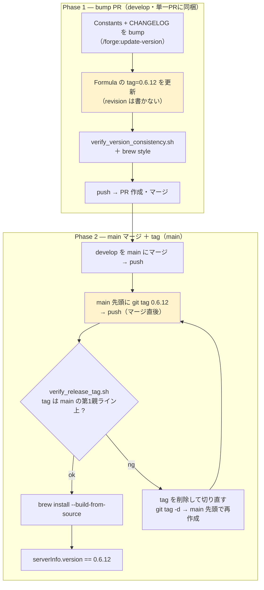
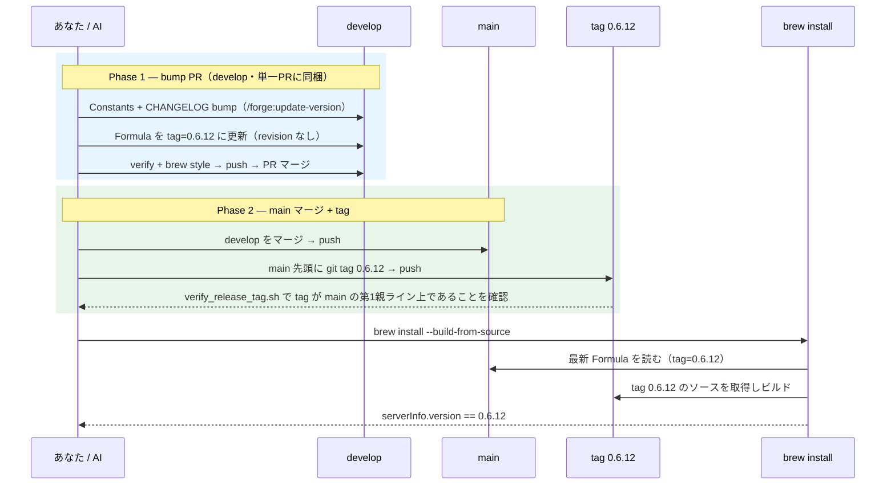

# コントリビューション

Issue、Pull Request を歓迎します！

使い方と Homebrew でのインストールは [README](README.md) を参照してください。本ガイドは **ソースからのビルド**・**ローカル開発セットアップ**・**リリース手順** を扱います。

English version: [CONTRIBUTING.md](CONTRIBUTING.md)

## ソースからのビルド

```bash
git clone https://github.com/BlueEventHorizon/Swift-Selena.git
cd Swift-Selena

# リリースビルド（本番用）
make build-release
# または直接: swift build -c release -Xswiftc -Osize

# デバッグビルド
make build
```

ビルド成果物は `.build/release/Swift-Selena`（または `.build/debug/Swift-Selena`）に生成されます。

### 利用可能な Make コマンド

```bash
make help  # 全コマンドを表示
```

| コマンド | 対象 | 説明 |
|---------|------|------|
| `make build` | — | DEBUG ビルド |
| `make build-release` | — | RELEASE ビルド |
| `make clean` | — | ビルド成果物をクリーン |
| `make connect_gemini` | Claude Code | gemini-cli MCP サーバーを接続 |
| `make disconnect_gemini` | Claude Code | gemini-cli MCP サーバーを切断 |
| `make register-release` | Claude Code | RELEASE 版を登録（プロジェクトパスを入力） |
| `make unregister-release` | Claude Code | RELEASE 版の登録を解除（プロジェクトパスを入力） |
| `make register-debug` | Claude Code | DEBUG 版をビルド＆Swift-Selena プロジェクトに登録 |
| `make unregister-debug` | Claude Code | DEBUG 版を Swift-Selena プロジェクトから解除 |
| `make register-desktop` | Claude Desktop | Claude Desktop に登録 |
| `make unregister-desktop` | Claude Desktop | Claude Desktop から解除 |

## 開発セットアップ

ローカルでビルドしたバイナリを（Homebrew のリリース版ではなく）Claude に登録するには、make ヘルパーか手動設定を使います。

### make を使う（開発時の推奨）

```bash
# Claude Desktop
make register-desktop

# Claude Code — 対象プロジェクトに登録
make register-release       # → 対象プロジェクトのパスを入力

# Claude Code — DEBUG ビルドを Swift-Selena プロジェクト自体に登録
make register-debug
```

登録解除:

```bash
make unregister-desktop
make unregister-release      # → 対象プロジェクトのパスを入力（空白でカレントディレクトリ）
make unregister-debug
```

### 手動設定

**Claude Desktop** — `~/Library/Application Support/Claude/claude_desktop_config.json` を編集:

```json
{
  "mcpServers": {
    "swift-selena": {
      "command": "/path/to/Swift-Selena/.build/release/Swift-Selena",
      "env": { "MCP_CLIENT_ID": "claude-desktop" }
    }
  },
  "isUsingBuiltInNodeForMcp": true
}
```

`/path/to/Swift-Selena` を実際のパスに置き換え、Claude Desktop を再起動してください。

**Claude Code** — 対象プロジェクトのディレクトリで:

```bash
claude mcp add swift-selena -- /path/to/Swift-Selena/.build/release/Swift-Selena
# グローバル（全プロジェクト）:
claude mcp add -s user swift-selena -- /path/to/Swift-Selena/.build/release/Swift-Selena
```

## リリース手順（メンテナ向け）

バージョン更新と Homebrew Formula の更新手順です。**正規かつ実行可能な手順は [CLAUDE.md](CLAUDE.md)**（release 運用順序のセクション）を出典とし、以下の図は理解補助です。

> **3 つの肝**
> 1. release tag は **`main` の第1親ライン**（main へマージした直後の merge commit / 先頭）に打つ。tag が main の本流に並ぶ
> 2. Formula には **`revision:` を書かず `tag:` のみ**にする。tag commit は Formula 自身を含むため、その SHA を Formula に書くことは原理的にできない（循環）。`revision` を持たなければ「tag と revision の不一致」（Issue #38）は起き得ない
> 3. main へのマージ後、**速やかに tag を打つ**（それまで Formula の `tag:` は未作成の tag を指す）

### フロー図（手順チェックリスト）



### シーケンス図（時系列と「なぜ」）


