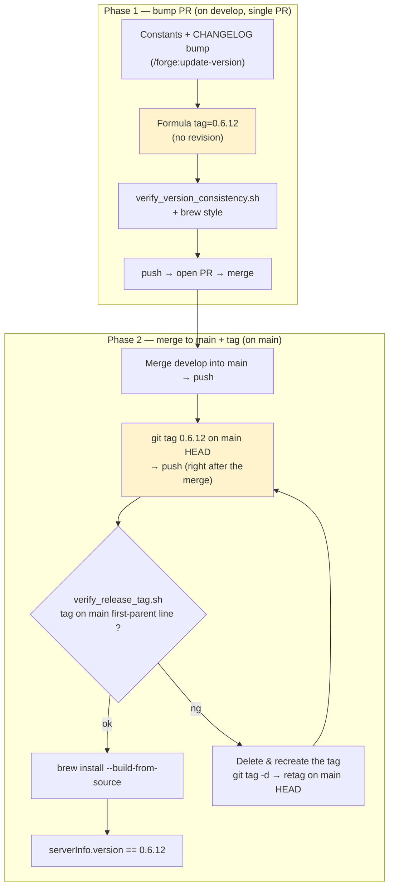
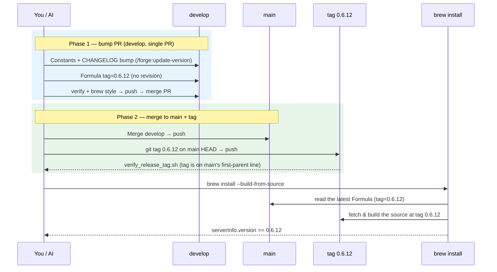

# Contributing

Issues and Pull Requests are welcome!

For usage and Homebrew installation, see the [README](README_en.md). This guide covers **building from source**, **local development setup**, and the **release procedure**.

Japanese version: [CONTRIBUTING.ja.md](CONTRIBUTING.ja.md)

## Building from source

```bash
git clone https://github.com/BlueEventHorizon/Swift-Selena.git
cd Swift-Selena

# Release build (production)
make build-release
# Or directly: swift build -c release -Xswiftc -Osize

# Debug build
make build
```

The build artifact is generated at `.build/release/Swift-Selena` (or `.build/debug/Swift-Selena`).

### Available Make Commands

```bash
make help  # Show all available commands
```

| Command | Target | Description |
|---------|--------|-------------|
| `make build` | — | Build debug version |
| `make build-release` | — | Build release version |
| `make clean` | — | Clean build artifacts |
| `make connect_gemini` | Claude Code | Connect gemini-cli MCP server |
| `make disconnect_gemini` | Claude Code | Disconnect gemini-cli MCP server |
| `make register-release` | Claude Code | Register RELEASE version (prompts for project path) |
| `make unregister-release` | Claude Code | Unregister RELEASE version (prompts for project path) |
| `make register-debug` | Claude Code | Build & register DEBUG version to the Swift-Selena project |
| `make unregister-debug` | Claude Code | Unregister DEBUG version from the Swift-Selena project |
| `make register-desktop` | Claude Desktop | Register to Claude Desktop |
| `make unregister-desktop` | Claude Desktop | Unregister from Claude Desktop |

## Development setup

To register your locally-built binary with Claude (instead of the Homebrew release), use either the make helpers or manual configuration.

### Using make (recommended for development)

```bash
# Claude Desktop
make register-desktop

# Claude Code — register to a target project
make register-release       # → prompts for the target project path

# Claude Code — register the DEBUG build to the Swift-Selena project itself
make register-debug
```

Unregister:

```bash
make unregister-desktop
make unregister-release      # → prompts for the target project path (blank = current dir)
make unregister-debug
```

### Manual configuration

**Claude Desktop** — edit `~/Library/Application Support/Claude/claude_desktop_config.json`:

```json
{
  "mcpServers": {
    "swift-selena": {
      "command": "/path/to/Swift-Selena/.build/release/Swift-Selena",
      "env": { "MCP_CLIENT_ID": "claude-desktop" }
    }
  },
  "isUsingBuiltInNodeForMcp": true
}
```

Replace `/path/to/Swift-Selena` with the actual path, then restart Claude Desktop.

**Claude Code** — in your target project directory:

```bash
claude mcp add swift-selena -- /path/to/Swift-Selena/.build/release/Swift-Selena
# Global (all projects):
claude mcp add -s user swift-selena -- /path/to/Swift-Selena/.build/release/Swift-Selena
```

## Release procedure (maintainers)

Steps for bumping the version and the Homebrew Formula. **The authoritative, executable procedure lives in [CLAUDE.md](CLAUDE.md)** (the release-flow section); the diagrams below are a visual aid.

> **Key points**
> 1. Put the release tag on **`main`'s first-parent line** (the merge commit / HEAD right after merging to `main`), so tags line up along `main`.
> 2. **Do not write `revision:` in the Formula** — only `tag:`. The tagged commit contains the Formula itself, so its SHA cannot be written into it (circular). Without `revision`, a tag/revision mismatch (Issue #38) cannot happen.
> 3. Tag **right after** merging to `main` (the Formula's `tag:` points at a tag that does not exist until then).

### Flowchart (step checklist)



### Sequence diagram (timing and the "why")


