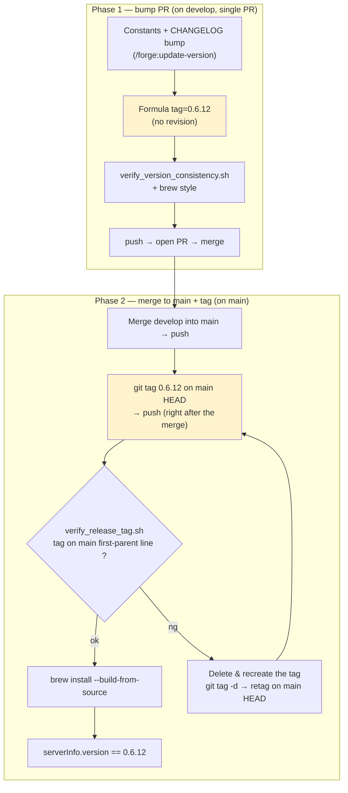
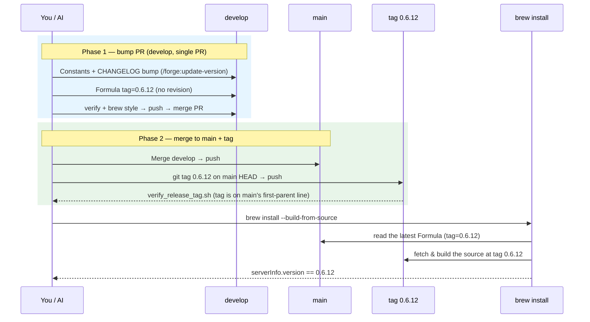

# Development Guide

A guide for Swift-Selena developers and maintainers. It covers **building, testing, debugging, adding tools, CI, and releasing**.

For usage and Homebrew installation, see [README.md](README.md). Issues and pull requests are welcome.

English | [日本語](ja/DEVELOPMENT.ja.md)

## Table of Contents

- [Environment](#environment)
- [Branching](#branching)
- [Build and Test](#build-and-test)
- [Registering a Local Build with a Client](#registering-a-local-build-with-a-client)
- [Project Layout](#project-layout)
- [How It Works](#how-it-works)
- [Adding a New Tool](#adding-a-new-tool)
- [Coding Conventions](#coding-conventions)
- [Debugging](#debugging)
- [Documentation](#documentation)
- [CI](#ci)
- [Release Procedure (maintainers)](#release-procedure-maintainers)

## Environment

- macOS 13.0 or later
- Swift 6.1 (Xcode 16.3) or later (verified on macOS 26 / Xcode 27.1, Swift 6.4). `Package.swift` declares `swift-tools-version: 6.1` because it is the lowest version that resolves the pinned dependencies (swift-nio 2.98.0 requires 6.1; swift-log 1.12.0 declares 6.2 but ships a `Package@swift-6.1.swift` manifest for 6.1); the language mode stays at Swift 5 (`swiftLanguageModes: [.v5]`)
- Dependencies (pinned in `Package.swift` with `exact`, so updates are deliberate):
  - [MCP Swift SDK](https://github.com/modelcontextprotocol/swift-sdk) 0.12.0
  - [SwiftSyntax](https://github.com/apple/swift-syntax) 602.0.0

```bash
git clone https://github.com/BlueEventHorizon/Swift-Selena.git
cd Swift-Selena
```

## Branching

| Branch           | Role                                                             |
| ---------------- | ---------------------------------------------------------------- |
| `main`           | Release history. Release tags go on `main`'s first-parent line   |
| `develop`        | Integration branch and the target of pull requests               |
| Working branches | Branch off `develop` (e.g. `feature/xxx`, `fix/xxx`, `docs/xxx`) |

1. Create a working branch from `develop` and commit
2. Open a pull request against `develop`. Writing `Closes #123` in the body closes the issue automatically on merge
3. At release time, merge `develop` into `main` ([Release Procedure](#release-procedure-maintainers))

Start commit messages with a prefix such as `add:`, `fix:`, `change:`, `docs:`, or `chore:`.

## Build and Test

```bash
make build            # DEBUG build
make build-release    # RELEASE build (swift build -c release -Xswiftc -Osize)
make clean            # clean build artifacts
swift test            # run tests
```

Artifacts are produced at `.build/debug/Swift-Selena` and `.build/release/Swift-Selena`.

> **`make build` / `make build-release` delete the analysis cache (`~/.swift-selena/clients/*/projects/*/memory.json`)** so stale caches do not survive a change in analysis logic. Running `swift build` directly does not delete it.

### Tests

Test targets registered in `Package.swift`:

| Target                          | Covers                                                                            |
| ------------------------------- | --------------------------------------------------------------------------------- |
| `SymbolVisitorV2Tests`          | Unit tests for `SymbolVisitorV2`                                                  |
| `SearchCodeToolTests`           | The `search_code` tool                                                            |
| `FindSymbolDefinitionToolTests` | The `find_symbol_definition` tool                                                 |
| `BackwardCompatibilityTests`    | Backward compatibility (e.g. handling of removed parameters)                      |
| `TypeConformanceCacheTests`     | Type conformance / import cache invalidation (file changes, additions, deletions) |

Sample code to analyze lives in `Tests/Fixtures/`. A new test target also needs to be registered in `Package.swift` (treat `Package.swift` changes carefully, as with adding dependencies).

### make commands

`make help` lists everything.

| Command                                          | Target         | Description                                                                                                                                                        |
| ------------------------------------------------ | -------------- | ------------------------------------------------------------------------------------------------------------------------------------------------------------------ |
| `make build`                                     | —              | DEBUG build                                                                                                                                                        |
| `make build-release`                             | —              | RELEASE build                                                                                                                                                      |
| `make clean`                                     | —              | Clean build artifacts                                                                                                                                              |
| `make register-claude`                           | Claude Code    | Register the RELEASE version (asks for a project path; leave empty to register for all projects, `-s user`)                                                        |
| `make unregister-claude`                         | Claude Code    | Unregister the RELEASE version (same prompt; empty = user scope)                                                                                                   |
| `make register-claude-app`                       | Claude Desktop | Register with the Claude Desktop app                                                                                                                               |
| `make unregister-claude-app`                     | Claude Desktop | Unregister from the Claude Desktop app                                                                                                                             |
| `make register-cursor`                           | Cursor         | Register the RELEASE version with Cursor (asks for a project path; leave empty for `~/.cursor/mcp.json`, all projects)                                             |
| `make unregister-cursor`                         | Cursor         | Unregister from Cursor (same prompt)                                                                                                                               |
| `make register-codex`                            | Codex          | Register the RELEASE version with Codex (`codex mcp add`, `~/.codex/config.toml`; the Codex CLI has no per-project option, so this always applies to all projects) |
| `make unregister-codex`                          | Codex          | Unregister from Codex (`codex mcp remove`)                                                                                                                         |
| `make register-claude-debug`                     | Claude Code    | Build the DEBUG version and register it with the Swift-Selena project                                                                                              |
| `make unregister-claude-debug`                   | Claude Code    | Unregister the DEBUG version from the Swift-Selena project                                                                                                         |
| `make connect_gemini` / `make disconnect_gemini` | Claude Code    | Connect / disconnect the gemini-cli MCP server                                                                                                                     |

## Registering a Local Build with a Client

Register a binary you built yourself (instead of the Homebrew release). **The MCP server is a separate process, so after rebuilding, restart the client (or reconnect the MCP server) to pick up the change.**

### With make (recommended)

```bash
make register-claude        # Claude Code — asks for a project path; leave empty for all projects (user scope)
make register-claude-app    # Claude Desktop app
make register-cursor        # Cursor — asks for a project path; leave empty for ~/.cursor/mcp.json
make register-codex         # Codex — codex mcp add (~/.codex/config.toml)
make register-claude-debug  # Claude Code — builds and registers the DEBUG build with the Swift-Selena project itself
```

All of these register the RELEASE build (`.build/release/Swift-Selena`, built with `make build-release`) except `register-claude-debug`. The Cursor and Codex registrations set `MCP_CLIENT_ID` to `cursor` / `codex`, so their caches are separate from Claude's.

To unregister: `make unregister-claude` / `make unregister-claude-app` / `make unregister-cursor` / `make unregister-codex` / `make unregister-claude-debug`.

### Manually

Replace `/path/to/Swift-Selena` with the real path.

**Claude Code** (in the target project's directory):

```bash
claude mcp add swift-selena -- /path/to/Swift-Selena/.build/release/Swift-Selena
# For all projects:
claude mcp add -s user swift-selena -- /path/to/Swift-Selena/.build/release/Swift-Selena
```

**Claude Desktop** — `~/Library/Application Support/Claude/claude_desktop_config.json`:

```json
{
  "mcpServers": {
    "swift-selena": {
      "command": "/path/to/Swift-Selena/.build/release/Swift-Selena",
      "env": { "MCP_CLIENT_ID": "claude-desktop" }
    }
  }
}
```

**Cursor** (`~/.cursor/mcp.json`) and **Codex** (`~/.codex/config.toml`) work the same way with that path as `command`. For the syntax, see [README.md](README.md#connecting-mcp-clients).

## Project Layout

```
Sources/
├── SwiftMCPServer.swift      # Entry point (starts the MCP server, handles ListTools / CallTool)
├── Constants.swift           # Constants (version, tool names, environment variable keys)
├── Logging/                  # Logging (~/.swift-selena/logs/server.log)
├── Selena/                   # Analysis engine
│   ├── Core/                 # FileSearcher, SwiftSyntaxAnalyzer, ProjectMemory
│   ├── LSP/                  # SourceKit-LSP integration (LSPClient, LSPState)
│   ├── Visitors/             # SwiftSyntax visitors (symbols, imports, property wrappers, ...)
│   └── DebugRunner.swift     # Automatic debug runner (DEBUG builds only)
└── Tools/                    # MCP tools
    ├── ToolProtocol.swift    # The MCPTool protocol and parameter helpers
    ├── Project/              # initialize_project
    ├── FileSystem/           # find_files, search_code, search_files_without_pattern
    ├── Symbols/              # list_symbols, find_symbol_definition
    ├── SwiftUI/              # list_property_wrappers, list_protocol_conformances, list_extensions
    ├── Analysis/             # analyze_imports, get_type_hierarchy, find_test_cases
    └── Meta/                 # Meta tools (list_available_tools, get_tool_schema, execute_tool) and the registry
Tests/                        # Tests and Tests/Fixtures (sample code to analyze)
scripts/                      # Scripts for registration, verification, and releasing
Formula/                      # Homebrew Formula
project/main/                 # Requirements, design, and plans (spec / design / plan / mcp-guide)
docs/                         # Rules, formats, and workflows
```

## How It Works

```
Client (Claude / Cursor / Codex, ...)
    ↓ JSON-RPC over stdio
SwiftMCPServer (MCP SDK)
    ↓ CallTool
Meta tool (execute_tool) → each tool (conforms to MCPTool)
    ↓
Analysis engine (SwiftSyntax / LSP / FileSearcher)
    ↓
ProjectMemory (cache of analysis results)
    ↓ response
Client
```

- **Meta tool mode (default)**: the client sees only `initialize_project`, `list_available_tools`, `get_tool_schema`, and `execute_tool`. `execute_tool` dispatches to the analysis tools by name
- **Legacy mode** (`SWIFT_SELENA_LEGACY=1`): 12 tools are exposed directly, and `ListTools` / `CallTool` in `SwiftMCPServer.swift` dispatch to them
- **Static analysis first**: SwiftSyntax is the foundation; LSP is auxiliary (disabled when a `.xcodeproj` exists directly under the project root; whether the project can be built is not checked)
- **Caching**: `ProjectMemory` persists analysis results under `~/.swift-selena/`

## Adding a New Tool

Use an existing, similar tool as a reference (e.g. `Sources/Tools/Symbols/ListSymbolsTool.swift`).

1. **Implement the tool**: create `Sources/Tools/<Category>/XxxTool.swift` conforming to `MCPTool` (`toolDefinition` and `execute`). Use `ToolHelpers` to read parameters. Return analysis errors as MCP error responses
2. **Define the tool name**: add it to `ToolNames` in `Sources/Constants.swift`
3. **Register it**: add it to `toolSummaries` (name, one-line description, category) and `getToolDefinition(_:)` in `Sources/Tools/Meta/MetaToolRegistry.swift`
4. **Meta mode dispatch**: add a case to the `switch` in `Sources/Tools/Meta/ExecuteToolTool.swift`
5. **Legacy mode dispatch**: add it to `ListTools` and `CallTool` in `Sources/SwiftMCPServer.swift`
6. **Tests**: add tests under `Tests/`, and register a target in `Package.swift` if needed
7. **Docs**: update "Provided Tools" in [README.md](README.md) and [ja/README.ja.md](ja/README.ja.md)

Choose a category from the existing `Analysis` / `FileSystem` / `Symbols` / `SwiftUI`.

## Coding Conventions

- **Write comments in Japanese** (if an existing file is written in English, match that file)
- **Code Header Format**: start each Swift file with a header comment beginning with `[Code Header Format]`, briefly describing the purpose, main features, contained types, and related types. See `Sources/Tools/ToolProtocol.swift` for an example. The spec is in `docs/format/code_header_format.md`
- **`Created by` in the file header** uses the value of `git config user.name`
- **Look for existing code first**: before writing something new, check `Sources/Tools/` and `Sources/Selena/` for a similar implementation
- **Keep it build-free**: analysis is SwiftSyntax-based; avoid depending too heavily on LSP

## Debugging

### Logs

```bash
tail -f ~/.swift-selena/logs/server.log
```

It shows startup, tool execution, LSP connection status, and errors.

### Starting the binary on its own

```bash
.build/debug/Swift-Selena
# If "Starting Swift MCP Server..." appears, it starts correctly. Exit with Ctrl+C
```

### Automatic runner in DEBUG builds

`Sources/Selena/DebugRunner.swift` is active in **DEBUG builds only**. It runs a test sequence automatically a few seconds after startup, in the same process as the MCP server. Run it from Xcode to trace it in the debugger.

### Checking every tool

In Claude Code, the `/mcp-test` skill tests all tools automatically (DEBUG build → `initialize_project` → run every tool → summary).

### Clearing the cache

If you suspect stale analysis results, delete the cache. It is rebuilt on the next `initialize_project`.

```bash
rm -rf ~/.swift-selena/
```

## Documentation

| Location                  | Contents                                                          |
| ------------------------- | ----------------------------------------------------------------- |
| `project/main/spec/`      | Requirements (`REQ-*`). **The highest priority of all documents** |
| `project/main/design/`    | Design documents (`DES-*`)                                        |
| `project/main/plan/`      | Development plans                                                 |
| `project/main/mcp-guide/` | Notes on the MCP SDK                                              |
| `docs/`                   | Development rules, document formats, and workflows                |
| `CHANGELOG.md`            | Release history                                                   |

When you change a specification, update the corresponding documents too.

## CI

| Workflow                                                | Trigger                           | What it does                                                                                                                                             |
| ------------------------------------------------------- | --------------------------------- | -------------------------------------------------------------------------------------------------------------------------------------------------------- |
| `version_check.yml` (Version Consistency Check)         | PRs; pushes to `main` / `develop` | Treats `Sources/Constants.swift` as canonical and verifies that the CHANGELOG and `.version-config.yaml` agree (`scripts/verify_version_consistency.sh`) |
| `release_tag_check.yml` (Release Tag Consistency Check) | Tag push                          | Verifies the tag is on `main`'s first-parent line and matches the version in Constants and the Formula (`scripts/verify_release_tag.sh`)                 |
| `bottle.yml` (Build Bottles)                            | Tag push, manual run              | Builds Homebrew bottles for Apple Silicon (macOS 15 / macOS 26) and attaches them to the GitHub Release                                                  |
| `close-issues-on-develop.yaml`                          | A PR merged into `develop`        | Closes the issues named by `Closes #N` in the PR body                                                                                                    |
| `claude.yml` (Claude Code)                              | Issue / PR comments, etc.         | Claude Code assistance                                                                                                                                   |

Local checks:

```bash
bash scripts/verify_version_consistency.sh   # version strings agree
brew style Formula/swift-selena.rb           # Formula syntax
```

## Version Notation

- **Canonical**: `AppConstants.version` in `Sources/Constants.swift` (e.g. `"0.6.12"`)
- **git tag**: `MAJOR.MINOR.PATCH` (**no `v` prefix**, e.g. `0.6.12`)
- **New CHANGELOG entries**: `## 0.6.12 - 2026-10-29` (no `v`). Past entries are not rewritten
- **`.version-config.yaml`**: `tag_format` is `"{version}"`
- Feature-introduction markers in the README such as "available since v0.6.3" may keep the `v`

Update the version with the `/forge:update-version` skill.

## Release Procedure (maintainers)

Steps for bumping the version and the Homebrew Formula. **The authoritative, executable procedure lives in [CLAUDE.md](CLAUDE.md)** (the release-flow section); the diagrams below are a visual aid.

> **Key points**
>
> 1. Put the release tag on **`main`'s first-parent line** (the merge commit / HEAD right after merging to `main`), so tags line up along `main`.
> 2. **Do not write `revision:` in the Formula** — only `tag:`. The tagged commit contains the Formula itself, so its SHA cannot be written into it (circular). Without `revision`, a tag/revision mismatch (Issue #38) cannot happen.
> 3. Tag **right after** merging to `main` (the Formula's `tag:` points at a tag that does not exist until then).

### Flowchart (step checklist)



### Sequence diagram (timing and the "why")



### Applying bottles (prebuilt binaries)

When a tag is pushed, `bottle.yml` builds bottles for Apple Silicon (macOS 15 / macOS 26) and attaches them to the GitHub Release. **CI does not push to the repository.** Applying them to the Formula goes through the normal branching flow.

1. **Check Actions**: confirm that **Build Bottles** succeeded and that Release `{version}` has `*.bottle.tar.gz` and `*.bottle.json` attached. To re-run without recreating the tag, use `Run workflow` on **Build Bottles** in Actions and enter `{version}` as the tag
2. **Create a working branch** from `develop`
3. **Apply to the Formula**: after authenticating with `gh auth login`, run the following. It writes a `bottle do` block into `Formula/swift-selena.rb`

   ```bash
   scripts/merge_bottles.sh {version}
   ```

4. **Review and commit**: check with `git diff Formula/swift-selena.rb` that only the `bottle do` block changed and that `brew style Formula/swift-selena.rb` passes, then commit
5. **Merge as usual**: develop → main. The bottle commit lands after the tag, but the Formula's `tag:` is unchanged, so tag consistency is preserved

> Environments without a bottle, such as Intel Macs, still build from source.

### Why the Formula has no `revision:`

The tag goes on the merge commit on `main`. That commit contains the Formula itself, so its SHA cannot be written into the Formula's `revision:` (writing it would change the SHA). The Formula therefore uses `tag:` only, which makes the earlier "tag commit vs `revision` mismatch" (Issue #38) impossible by construction.
