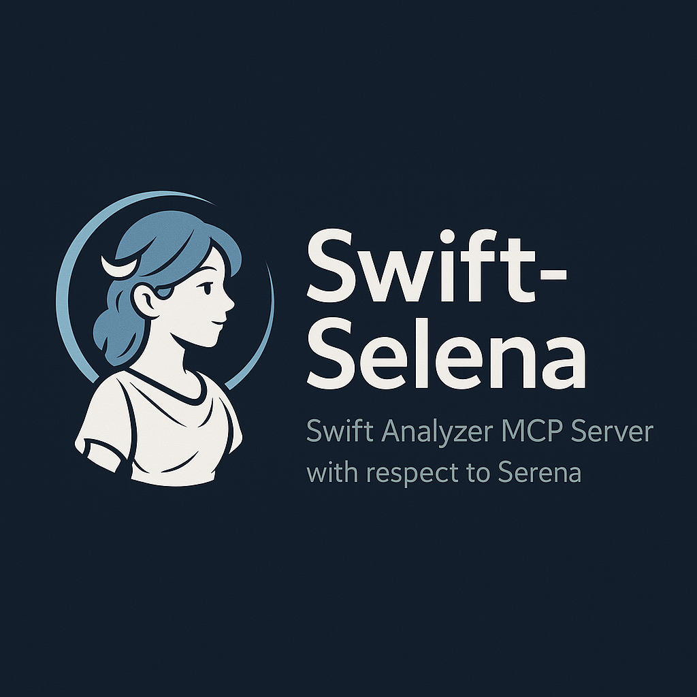

# Swift Selena - Swift Analyzer MCP Server with respect to Serena



**Swift Selena** は、Swift プロジェクトのコード解析を AI エージェントに提供する MCP (Model Context Protocol) サーバーです。ビルドエラーがあるコードでも動作し、SwiftUI アプリ開発を強力にサポートします。Claude Code / Claude Desktop / Cursor / Codex など、MCP 対応のクライアントから利用できます。

[](https://swift.org)
[](https://www.apple.com/macos/)
[](LICENSE)

[English version](README_en.md)

## 目次

- [主な特徴](#主な特徴)
- [クイックスタート](#クイックスタート)
- [インストール](#インストール)
- [MCP クライアントへの登録](#mcp-クライアントへの登録)
- [使い方](#使い方)
- [提供ツール](#提供ツール)
- [設定・データ・ログ](#設定データログ)
- [トラブルシューティング](#トラブルシューティング)
- [高度な設定](#高度な設定)
- [アーキテクチャ](#アーキテクチャ)
- [コントリビューション・ライセンス](#コントリビューションライセンス)

## 主な特徴

- **ビルド不要**: SwiftSyntax ベースの静的解析により、ビルドエラーがあっても動作します
- **LSP 統合**: 利用可能な場合は SourceKit-LSP で対応ツールを強化し、不可の場合は SwiftSyntax で動作します
- **メタツールモード**: 動的ツールロードでコンテキストウィンドウの使用量を削減します（v0.6.3+）
- **Swift Testing 対応**: XCTest と Swift Testing（`@Test`, `@Suite`）の両方を検出します
- **SwiftUI 対応**: Property Wrapper（`@State`, `@Binding` 等）を自動検出します
- **高速検索**: ファイルシステムベースの検索で、大規模プロジェクトでも高速です
- **スマートキャッシュ**: 解析結果をキャッシュし、繰り返しのクエリを高速化します
- **複数クライアント対応**: Claude Code・Claude Desktop・Cursor・Codex を同時に使えます（クライアントごとにデータを分離）

## クイックスタート

```bash
# 1. インストール（bottle があれば数秒で完了します）
brew tap blueeventhorizon/swift-selena https://github.com/BlueEventHorizon/Swift-Selena
brew install blueeventhorizon/swift-selena/swift-selena

# 2. 使っているクライアントに登録（例: Claude Code）
claude mcp add swift-selena -- swift-selena
```

3. クライアントで Swift プロジェクトを開き、「このプロジェクトを解析して」と頼みます。

Claude Desktop・Cursor・Codex の登録方法は [MCP クライアントへの登録](#mcp-クライアントへの登録) を参照してください。

## インストール

### 必要要件

- macOS 13.0 以上
- MCP に対応したクライアント（[Claude Code](https://docs.claude.com/claude-code) / [Claude Desktop](https://claude.ai/download) / [Cursor](https://cursor.com) / [Codex](https://developers.openai.com/codex) など）
- ソースからビルドする場合のみ: Swift 5.9 以上

### Homebrew（推奨）

本リポジトリ自体を tap として利用できます（専用の `homebrew-*` リポジトリは不要です）。

```bash
brew tap blueeventhorizon/swift-selena https://github.com/BlueEventHorizon/Swift-Selena
brew install blueeventhorizon/swift-selena/swift-selena
# tap 後は短縮形も使えます:
# brew install swift-selena
```

インストール後、`swift-selena` が `PATH` 上（通常は `$(brew --prefix)/bin/swift-selena`）に配置されます。

#### インストール時間について

| 状況 | 所要時間 | 内容 |
| --- | --- | --- |
| bottle あり（Apple Silicon・macOS 15 / macOS 26） | 数秒 | ビルド済みバイナリを取得するだけです |
| bottle なし（Intel Mac・未対応 OS・bottle 未公開のバージョン） | 数分〜十数分 | ソースからビルドします。swift-syntax などの依存もコンパイルするため時間がかかります（Apple Silicon・Xcode 27.1 で約 3 分） |

ソースビルドになる場合の要件:

- macOS 13.0+ 上で Swift 5.9+ が必要です。動作確認済みの環境は macOS 26 / Xcode 27.1（Swift 6.4）です
- Command Line Tools のみでのビルドは**未検証**です。CLT のみの環境で失敗する場合は、フル Xcode をインストールしてください

> **`brew doctor` の「Command Line Tools for Xcode xx をダウンロードしてください」という警告について**
> Homebrew が、Xcode と Command Line Tools のバージョン差を検出して出す警告です。`swift build` は `xcode-select` が指す Xcode のツールチェーンを使うため、Swift-Selena のビルドには影響しません。

### ソースからビルド（代替）

Homebrew が使えない環境では、手動でビルドします。

```bash
git clone https://github.com/BlueEventHorizon/Swift-Selena.git
cd Swift-Selena
swift build -c release -Xswiftc -Osize
# 成果物: .build/release/Swift-Selena
```

以降の登録手順では、`swift-selena` を `$(pwd)/.build/release/Swift-Selena` に読み替えてください。`make` コマンド、ローカル開発時の登録、リリース手順は [CONTRIBUTING.ja.md](CONTRIBUTING.ja.md) を参照してください。

## MCP クライアントへの登録

どのクライアントも、`swift-selena` を **stdio** の MCP サーバーとして起動します。

| クライアント | 設定方法 | 設定ファイル |
| --- | --- | --- |
| [Claude Code](#claude-code) | `claude mcp add` | `~/.claude.json` / `.mcp.json` |
| [Claude Desktop](#claude-desktop) | JSON を編集 | `~/Library/Application Support/Claude/claude_desktop_config.json` |
| [Cursor](#cursor) | JSON を編集 | `~/.cursor/mcp.json` / `.cursor/mcp.json` |
| [Codex（CLI / IDE 拡張）](#codex) | `codex mcp add` または TOML を編集 | `~/.codex/config.toml` / `.codex/config.toml` |

### 共通の注意

- **GUI アプリ（Claude Desktop・Cursor・Codex IDE 拡張）は、シェルの `PATH` を継承しないことがあります。** 設定には絶対パスを書くのが確実です。絶対パスは次のコマンドで確認できます。

  ```bash
  echo "$(brew --prefix)/bin/swift-selena"
  # 例: Apple Silicon → /opt/homebrew/bin/swift-selena / Intel → /usr/local/bin/swift-selena
  ```

- **JSON や TOML の中に `$(brew --prefix)` を書かないでください。** シェル展開されないため、上のコマンドで得た絶対パスをそのまま貼り付けます。
- **`MCP_CLIENT_ID` でクライアントごとにデータを分離します。** 同じ値を使うクライアントは、同じ解析キャッシュを共有します。詳細は [データ保存場所](#データ保存場所) を参照してください。

以下の例は、Apple Silicon の Homebrew（`/opt/homebrew`）を想定しています。

### Claude Code

バイナリが `PATH` 上にあれば、絶対パスは不要です。スコープを選んでください。

| スコープ | コマンド | 有効範囲 |
| --- | --- | --- |
| `local`（デフォルト） | `claude mcp add swift-selena -- swift-selena` | このプロジェクトのみ・自分だけ |
| `project` | `claude mcp add -s project swift-selena -- swift-selena` | このプロジェクト・`.mcp.json` でチーム共有 |
| `user` | `claude mcp add -s user swift-selena -- swift-selena` | 自分の全プロジェクト |

> **`project` スコープの注意:** `.mcp.json` をリポジトリにコミットしてチームで共有します。`command` が `swift-selena`（`PATH` で解決）なので、**チームメンバー全員が `swift-selena` を `PATH` 上に持っている**（例: この Homebrew formula で導入）必要があります。

### Claude Desktop

`~/Library/Application Support/Claude/claude_desktop_config.json` を編集します。

```json
{
  "mcpServers": {
    "swift-selena": {
      "command": "/opt/homebrew/bin/swift-selena",
      "env": { "MCP_CLIENT_ID": "claude-desktop" }
    }
  }
}
```

編集後、Claude Desktop を再起動します。

### Cursor

プロジェクト単位は `.cursor/mcp.json`、全プロジェクト共通は `~/.cursor/mcp.json` を編集します。

```json
{
  "mcpServers": {
    "swift-selena": {
      "type": "stdio",
      "command": "/opt/homebrew/bin/swift-selena",
      "env": { "MCP_CLIENT_ID": "cursor" }
    }
  }
}
```

- 保存後、Cursor の **Customize** サイドバーで `swift-selena` が有効になっていることを確認します。チャットの `Available Tools` に表示されれば接続できています
- 接続に失敗する場合は、Output パネル（`Cmd+Shift+U`）で **MCP Logs** を選んでエラーを確認します
- `.cursor/mcp.json` をリポジトリにコミットする場合は、`command` の絶対パスがチーム全員の環境で同じであることを確認してください

### Codex

Codex CLI・IDE 拡張・デスクトップアプリは、同じ設定を共有します。

**コマンドで登録する場合:**

```bash
codex mcp add swift-selena --env MCP_CLIENT_ID=codex -- "$(brew --prefix)/bin/swift-selena"
```

`$(brew --prefix)` はシェルがコマンド実行前に展開するため、登録されるのは絶対パスです。

**設定ファイルを直接編集する場合:** `~/.codex/config.toml`（プロジェクト単位は `.codex/config.toml`。信頼済みのプロジェクトのみ有効）に追記します。

```toml
[mcp_servers.swift-selena]
command = "/opt/homebrew/bin/swift-selena"

[mcp_servers.swift-selena.env]
MCP_CLIENT_ID = "codex"
```

- 登録を確認するには、`codex mcp list` を実行するか、Codex の画面で `/mcp` と入力します
- IDE 拡張からは、歯車メニューの **MCP servers** → **Add server** → **STDIO** でも追加できます。追加後に **Restart extension** を実行します

## 使い方

### 基本的な流れ

1. **プロジェクトを初期化する**: クライアントに「この Swift プロジェクトを解析して」と頼むと、`initialize_project` が自動で実行されます
2. **コードを検索・解析する**: 「ViewModel を探して」→ `find_files` で `*ViewModel.swift` を検索します。「`@State` を使っているファイルは？」→ `list_property_wrappers` で検出します
3. **コード構造を調べる**: 「ViewController の型階層を表示して」→ `get_type_hierarchy` で継承関係を表示します

### 実践例

#### SwiftUI の Property Wrapper を確認

```
あなた: ContentView.swift で使われている Property Wrapper を教えて

AI: list_property_wrappers を実行
結果:
[@State] counter: Int (line 12)
[@ObservedObject] viewModel: ViewModel (line 13)
[@EnvironmentObject] appState: AppState (line 14)
```

#### 特定の関数を探す

```
あなた: fetchData という関数がどこにあるか探して

AI: find_symbol_definition を実行
結果:
[Function] fetchData
  File: /path/to/NetworkManager.swift
  Line: 45
```

#### Protocol 準拠を確認

```
あなた: ViewController がどのプロトコルに準拠しているか教えて

AI: list_protocol_conformances を実行
結果:
[Class] ViewController (line 25)
  Inherits from: UIViewController
  Conforms to: UITableViewDelegate, UITableViewDataSource
```

#### 本番コードの Swift ファイルだけを検索

```json
{
  "pattern": "URLSession\\.shared",
  "output_mode": "file_list",
  "include_patterns": ["Sources/**/*.swift"],
  "exclude_patterns": ["*Tests*"],
  "limit": 100
}
```

（`search_code` のパラメータ例です）

#### シンボル定義を種別で絞り込む

```json
{
  "symbol_name": "Button",
  "symbol_kinds": ["struct", "class"]
}
```

（`find_symbol_definition` のパラメータ例です。結果には Scope 行と structured JSON ブロックが含まれます）

## 提供ツール

### メタツールモード（v0.6.3+）

Swift-Selena は**メタツールモード**を採用しており、クライアントには次の 4 つのツールだけを公開します。実際の解析ツールはオンデマンドで動的にロードされるため、コンテキストウィンドウの使用量を抑えられます。

| 公開ツール | 役割 |
| --- | --- |
| `initialize_project` | プロジェクトを初期化します（最初に必ず実行） |
| `list_available_tools` | 利用可能な解析ツールの一覧と説明を表示します |
| `get_tool_schema` | 特定ツールの JSON スキーマを取得します |
| `execute_tool` | 解析ツールを名前で実行します |

### 解析ツール（`execute_tool` 経由）

| カテゴリ | ツール | 概要 |
| --- | --- | --- |
| ファイル検索 | `find_files` | ワイルドカードパターンでファイルを検索（例: `*ViewModel.swift`） |
| | `search_code` | 正規表現でコード内容を検索。`output_mode`・`limit`・`include_patterns`・`exclude_patterns` に対応 |
| | `search_files_without_pattern` | パターンにマッチしないファイルを検索（`grep -L` 相当）。`include_patterns`・`exclude_patterns` に対応 |
| シンボル解析 | `list_symbols` | Class・Struct・Function などのシンボル一覧 |
| | `find_symbol_definition` | プロジェクト全体でシンボル定義を検索。`symbol_kinds` とスコープ情報に対応 |
| SwiftUI 解析 | `list_property_wrappers` | SwiftUI の Property Wrapper（`@State`, `@Binding` 等）を検出 |
| | `list_protocol_conformances` | Protocol 準拠と継承関係を解析（`UITableViewDelegate`, `ObservableObject` 等） |
| | `list_extensions` | Extension を解析（拡張対象の型・プロトコル準拠・メンバー一覧） |
| コード解析 | `analyze_imports` | プロジェクト全体の Import 依存関係を解析（モジュール使用統計、キャッシュ利用） |
| | `get_type_hierarchy` | 型の継承階層を取得（スーパークラス・サブクラス・Protocol 準拠型、キャッシュ利用） |
| | `find_test_cases` | XCTest と Swift Testing（`@Test`, `@Suite`）のテストケースを検出 |

### ツール仕様の補足

- `search_code` の `output_mode` は `match_detail`（既定）、`file_list`、`count_only` です
- `search_code` の `limit` は 1〜10,000 です。10,000 を超える値は内部上限に切り詰められ、結果に通知されます
- `search_code` と `search_files_without_pattern` は `include_patterns` / `exclude_patterns` を使用します。旧 `file_pattern` は意図的に廃止済みで、指定されても無視されます
- `find_symbol_definition` の `symbol_kinds` には、`struct`・`class`・`enum`・`protocol`・`actor`・`function`・`variable`・`typealias`・`extension` を指定できます
- `search_code` と `find_symbol_definition` は、人間向けテキスト出力の末尾に `--- structured ---` の JSON ブロックを付加します
- LSP 強化はベストエフォートです。`.xcodeproj` を含む Xcode プロジェクトのディレクトリでは現在 LSP を無効化し、SwiftSyntax 解析にフォールバックします

## 設定・データ・ログ

### データ保存場所

解析キャッシュは `~/.swift-selena/` に保存されます。

```
~/.swift-selena/
├── logs/
│   └── server.log                # ログ
└── clients/
    ├── default/                  # MCP_CLIENT_ID 未設定（Claude Code など）
    │   └── projects/
    │       └── YourProject-abc12345/
    │           └── memory.json
    ├── claude-desktop/           # MCP_CLIENT_ID=claude-desktop
    ├── cursor/                   # MCP_CLIENT_ID=cursor
    └── codex/                    # MCP_CLIENT_ID=codex
```

- プロジェクトパスの SHA256 ハッシュで同一プロジェクトを識別し、異なるプロジェクトは自動的に分離されます
- `MCP_CLIENT_ID` が異なるクライアントは、データが自動的に分離されます（未設定の場合は `default`）

> **注意:** 同じ `MCP_CLIENT_ID`（例: 複数の Claude Code ウィンドウ）で同じプロジェクトを同時に開くと、メモリファイルへの書き込みが競合する可能性があります。同じプロジェクトを複数のウィンドウで作業する場合は、異なる `MCP_CLIENT_ID` を設定してください。

### ログ（v0.5.3+）

デバッグ用のログは `~/.swift-selena/logs/server.log` に出力されます。

```bash
# リアルタイムで監視
tail -f ~/.swift-selena/logs/server.log
```

サーバーの起動、ツールの実行、LSP の接続状態（成功 / 失敗）、エラーと診断情報を確認できます。

```
[17:29:24] ℹ️ [info] Starting Swift MCP Server...
[17:29:50] ℹ️ [info] Tool called: initialize_project
[17:29:50] ℹ️ [info] Attempting LSP connection...
[17:29:51] ℹ️ [info] ✅ LSP connected successfully
```

## トラブルシューティング

### MCP サーバーが起動しない

バイナリが起動し、開始バナーを表示するか確認します。

```bash
swift-selena
# "Starting Swift MCP Server..." が表示されれば OK。Ctrl+C で終了
```

ソースからビルドした場合は `.build/release/Swift-Selena` を実行してください。

### ツールが見つからない・接続できない

1. クライアントを再起動します（Codex IDE 拡張は **Restart extension**）
2. 設定ファイルのパスと `command` の絶対パスが正しいか確認します
3. クライアント側のログを確認します

| クライアント | 確認方法 |
| --- | --- |
| Claude Code | `claude mcp list` |
| Claude Desktop | `tail -f ~/Library/Logs/Claude/mcp*.log` |
| Cursor | Output パネル（`Cmd+Shift+U`）→ **MCP Logs** |
| Codex | `codex mcp list` / `/mcp` |

サーバー自身のログは `~/.swift-selena/logs/server.log` にあります。

### `brew install` が遅い

bottle が無い環境では、ソースからビルドするため数分〜十数分かかります。詳細は [インストール時間について](#インストール時間について) を参照してください。

### 古いキャッシュをクリア

```bash
rm -rf ~/.swift-selena/
```

次回の `initialize_project` 実行時に再構築されます。

## 高度な設定

### レガシーモード（全ツール直接公開）

デフォルトでは**メタツールモード**（v0.6.3+）を使用します。メタツールを経由せず 12 個のツールを直接公開したい場合は、環境変数 `SWIFT_SELENA_LEGACY=1` を設定します。

| クライアント | 設定 |
| --- | --- |
| Claude Code | `claude mcp add swift-selena -e SWIFT_SELENA_LEGACY=1 -- swift-selena` |
| Claude Desktop・Cursor | `env` に `"SWIFT_SELENA_LEGACY": "1"` を追加します |
| Codex | `codex mcp add swift-selena --env SWIFT_SELENA_LEGACY=1 -- swift-selena`、または `[mcp_servers.swift-selena.env]` に `SWIFT_SELENA_LEGACY = "1"` を追加します |

Claude Desktop の例:

```json
{
  "mcpServers": {
    "swift-selena": {
      "command": "/opt/homebrew/bin/swift-selena",
      "env": {
        "MCP_CLIENT_ID": "claude-desktop",
        "SWIFT_SELENA_LEGACY": "1"
      }
    }
  }
}
```

レガシーモードで直接公開される 12 個のツール:
`initialize_project`、`find_files`、`search_code`、`search_files_without_pattern`、`list_symbols`、`find_symbol_definition`、`list_property_wrappers`、`list_protocol_conformances`、`list_extensions`、`analyze_imports`、`get_type_hierarchy`、`find_test_cases`

## アーキテクチャ

### コアコンポーネント

- **FileSearcher**: ファイルシステムベースの高速検索
- **SwiftSyntaxAnalyzer**: AST 解析によるシンボル抽出
- **ProjectMemory**: 解析結果の永続化とキャッシュ管理

### 技術スタック

- **[MCP Swift SDK](https://github.com/modelcontextprotocol/swift-sdk)** (0.12.0) - MCP プロトコル実装
- **[SwiftSyntax](https://github.com/apple/swift-syntax)** (602.0.0) - 構文解析
- **CryptoKit** - プロジェクトパスのハッシュ化
- **swift-log**（MCP Swift SDK 経由） - ロギング

## コントリビューション・ライセンス

Issue・Pull Request を歓迎します。メンテナ向けのリリース手順（バージョン更新 + Homebrew Formula、図解付き）は [CONTRIBUTING.ja.md](CONTRIBUTING.ja.md) を参照してください。

MIT License - 詳細は [LICENSE](LICENSE) を参照してください。

## 参考

- [Model Context Protocol](https://modelcontextprotocol.io/) - MCP プロトコル仕様
- [SwiftSyntax](https://github.com/apple/swift-syntax) - Swift 構文解析ライブラリ
- [Anthropic](https://www.anthropic.com/) - Claude AI
