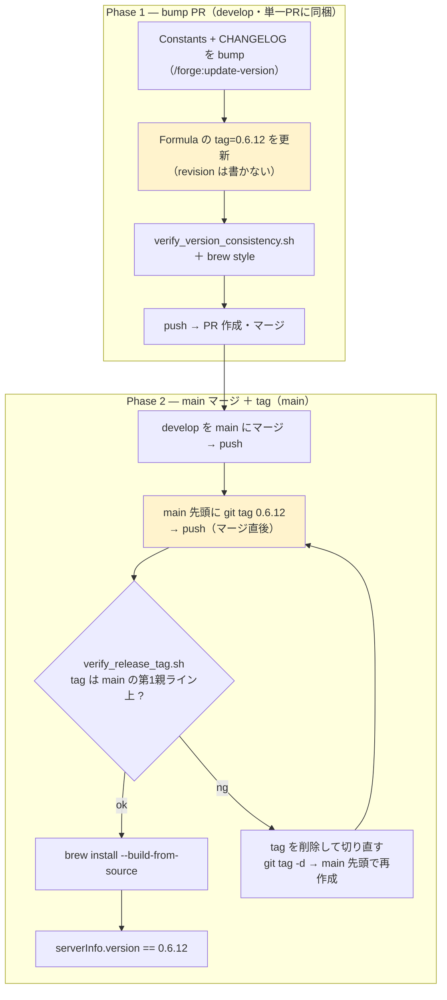
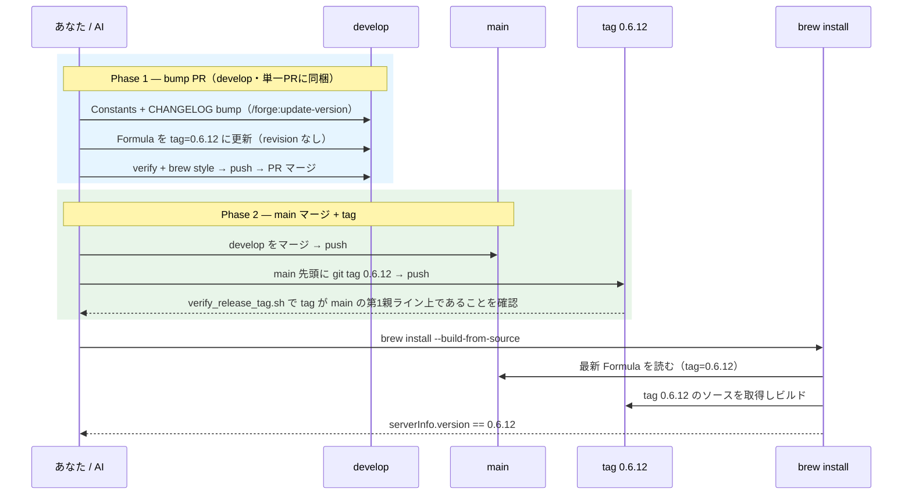

<!-- bilingual-docs: source=DEVELOPMENT.md sha256=4a52b60638d8 -->

# 開発ガイド

Swift-Selena の開発者・メンテナ向けガイドです。**ビルド・テスト・デバッグ・ツールの追加・CI・リリース**を扱います。

使い方と Homebrew でのインストールは [README.md](README.ja.md) を参照してください。Issue・Pull Request を歓迎します。

[English](../DEVELOPMENT.md) | 日本語

## 目次

- [開発環境](#開発環境)
- [ブランチ運用](#ブランチ運用)
- [ビルドとテスト](#ビルドとテスト)
- [ローカルビルドをクライアントに登録する](#ローカルビルドをクライアントに登録する)
- [プロジェクト構成](#プロジェクト構成)
- [動作の流れ](#動作の流れ)
- [新しいツールを追加する](#新しいツールを追加する)
- [コーディング規約](#コーディング規約)
- [デバッグ](#デバッグ)
- [ドキュメント](#ドキュメント)
- [CI](#ci)
- [リリース手順（メンテナ向け）](#リリース手順メンテナ向け)

## 開発環境

- macOS 13.0 以上
- Swift 6.1（Xcode 16.3）以上（動作確認済み: macOS 26 / Xcode 27.1・Swift 6.4）。固定された依存パッケージを解決できる最小のバージョンとして、`Package.swift` は `swift-tools-version: 6.1` を宣言しています（swift-nio 2.98.0 が 6.1 を要求。swift-log 1.12.0 は 6.2 を宣言するものの 6.1 向けの `Package@swift-6.1.swift` を同梱）。言語モードは Swift 5 のままです（`swiftLanguageModes: [.v5]`）
- 依存パッケージ（`Package.swift` で固定。`exact` 指定のため、更新は意図的に行います）:
  - [MCP Swift SDK](https://github.com/modelcontextprotocol/swift-sdk) 0.12.0
  - [SwiftSyntax](https://github.com/apple/swift-syntax) 602.0.0

```bash
git clone https://github.com/BlueEventHorizon/Swift-Selena.git
cd Swift-Selena
```

## ブランチ運用

| ブランチ | 役割 |
| --- | --- |
| `main` | リリース済みの履歴。release tag は `main` の本流に打ちます |
| `develop` | 開発の統合先。Pull Request の宛先です |
| 作業ブランチ | `develop` から切ります（例: `feature/xxx`、`fix/xxx`、`docs/xxx`） |

1. `develop` から作業ブランチを作成して commit します
2. Pull Request を `develop` 宛てに作成します。本文に `Closes #123` と書くと、merge 時に Issue が自動でクローズされます
3. リリース時に `develop` を `main` に merge します（[リリース手順](#リリース手順メンテナ向け)）

commit メッセージは `add:`・`fix:`・`change:`・`docs:`・`chore:` などの接頭辞で始めます（例: `fix: bottle.yml の publish ジョブで gh の対象 repo を明示`）。

## ビルドとテスト

```bash
make build            # DEBUG ビルド
make build-release    # RELEASE ビルド（swift build -c release -Xswiftc -Osize）
make clean            # ビルド成果物をクリーン
swift test            # テスト実行
```

ビルド成果物は `.build/debug/Swift-Selena` と `.build/release/Swift-Selena` に生成されます。

> **`make build` / `make build-release` は、解析キャッシュ（`~/.swift-selena/clients/*/projects/*/memory.json`）を削除します。** 解析ロジックを変更した後に古いキャッシュが残らないようにするためです。`swift build` を直接実行した場合は削除されません。

### テスト

`Package.swift` に登録されているテストターゲット:

| ターゲット | 対象 |
| --- | --- |
| `SymbolVisitorV2Tests` | `SymbolVisitorV2` の単体テスト |
| `SearchCodeToolTests` | `search_code` ツール |
| `FindSymbolDefinitionToolTests` | `find_symbol_definition` ツール |
| `BackwardCompatibilityTests` | 後方互換（廃止パラメータの扱いなど） |
| `TypeConformanceCacheTests` | 型準拠 / Import キャッシュの無効化（ファイルの変更・追加・削除への追従） |

解析対象のサンプルコードは `Tests/Fixtures/` にあります。新しいテストターゲットを追加する場合は、`Package.swift` への登録も必要です（`Package.swift` の変更は、依存の追加と同様に慎重に扱ってください）。

### make コマンド一覧

`make help` で全コマンドを表示できます。

| コマンド | 対象 | 説明 |
| --- | --- | --- |
| `make build` | — | DEBUG ビルド |
| `make build-release` | — | RELEASE ビルド |
| `make clean` | — | ビルド成果物をクリーン |
| `make register-claude` | Claude Code | RELEASE 版を登録（対象プロジェクトのパスを入力） |
| `make unregister-claude` | Claude Code | RELEASE 版の登録を解除（対象プロジェクトのパスを入力） |
| `make register-claude-app` | Claude Desktop | Claude Desktop アプリに登録 |
| `make unregister-claude-app` | Claude Desktop | Claude Desktop アプリから解除 |
| `make register-cursor` | Cursor | RELEASE 版を Cursor に登録（対象プロジェクトのパスを入力。空白なら全プロジェクト共通の `~/.cursor/mcp.json`） |
| `make unregister-cursor` | Cursor | Cursor から解除（同じ入力） |
| `make register-codex` | Codex | RELEASE 版を Codex に登録（`codex mcp add`、`~/.codex/config.toml`） |
| `make unregister-codex` | Codex | Codex から解除（`codex mcp remove`） |
| `make register-claude-debug` | Claude Code | DEBUG 版をビルドし、Swift-Selena プロジェクトに登録 |
| `make unregister-claude-debug` | Claude Code | DEBUG 版を Swift-Selena プロジェクトから解除 |
| `make connect_gemini` / `make disconnect_gemini` | Claude Code | gemini-cli MCP サーバーの接続 / 切断 |

## ローカルビルドをクライアントに登録する

Homebrew のリリース版ではなく、手元でビルドしたバイナリを登録します。**MCP サーバーは別プロセスなので、再ビルドしたら、クライアントを再起動（または MCP の再接続）して反映してください。**

### make を使う（推奨）

```bash
make register-claude        # Claude Code — 対象プロジェクトのパスを入力
make register-claude-app    # Claude Desktop アプリ
make register-cursor        # Cursor — 対象プロジェクトのパスを入力（空白なら ~/.cursor/mcp.json）
make register-codex         # Codex — codex mcp add（~/.codex/config.toml）
make register-claude-debug  # Claude Code — DEBUG ビルドを作って Swift-Selena プロジェクト自体に登録
```

`register-claude-debug` 以外はすべて RELEASE ビルド（`make build-release` で作る `.build/release/Swift-Selena`）を登録します。Cursor と Codex への登録では `MCP_CLIENT_ID` を `cursor` / `codex` に設定するので、キャッシュは Claude 側と分離されます。

解除は `make unregister-claude` / `make unregister-claude-app` / `make unregister-cursor` / `make unregister-codex` / `make unregister-claude-debug` です。

### 手動で登録する

`/path/to/Swift-Selena` を実際のパスに置き換えてください。

**Claude Code**（対象プロジェクトのディレクトリで）:

```bash
claude mcp add swift-selena -- /path/to/Swift-Selena/.build/release/Swift-Selena
# 全プロジェクト共通にする場合:
claude mcp add -s user swift-selena -- /path/to/Swift-Selena/.build/release/Swift-Selena
```

**Claude Desktop** — `~/Library/Application Support/Claude/claude_desktop_config.json`:

```json
{
  "mcpServers": {
    "swift-selena": {
      "command": "/path/to/Swift-Selena/.build/release/Swift-Selena",
      "env": { "MCP_CLIENT_ID": "claude-desktop" }
    }
  }
}
```

**Cursor** — `~/.cursor/mcp.json`、**Codex** — `~/.codex/config.toml` も、`command` を上のパスにすれば同じ要領で登録できます。書式は [README.md](README.ja.md#mcp-クライアントへの登録) を参照してください。

## プロジェクト構成

```
Sources/
├── SwiftMCPServer.swift      # エントリーポイント（MCP サーバーの起動、ListTools / CallTool の処理）
├── Constants.swift           # 定数（バージョン、ツール名、環境変数キー）
├── Logging/                  # ログ出力（~/.swift-selena/logs/server.log）
├── Selena/                   # 解析エンジン
│   ├── Core/                 # FileSearcher、SwiftSyntaxAnalyzer、ProjectMemory
│   ├── LSP/                  # SourceKit-LSP 連携（LSPClient、LSPState）
│   ├── Visitors/             # SwiftSyntax の Visitor 群（シンボル、Import、Property Wrapper 等）
│   └── DebugRunner.swift     # デバッグ用の自動実行（DEBUG ビルドのみ）
└── Tools/                    # MCP ツール
    ├── ToolProtocol.swift    # MCPTool プロトコルとパラメータ取得ヘルパー
    ├── Project/              # initialize_project
    ├── FileSystem/           # find_files、search_code、search_files_without_pattern
    ├── Symbols/              # list_symbols、find_symbol_definition
    ├── SwiftUI/              # list_property_wrappers、list_protocol_conformances、list_extensions
    ├── Analysis/             # analyze_imports、get_type_hierarchy、find_test_cases
    └── Meta/                 # メタツール（list_available_tools、get_tool_schema、execute_tool）とレジストリ
Tests/                        # テストと Tests/Fixtures（解析対象のサンプル）
scripts/                      # 登録・検証・リリース用のスクリプト
Formula/                      # Homebrew Formula
project/main/                 # 要件・設計・計画（spec / design / plan / mcp-guide）
docs/                         # ルール・フォーマット・ワークフロー
```

## 動作の流れ

```
クライアント（Claude / Cursor / Codex など）
    ↓ JSON-RPC over stdio
SwiftMCPServer（MCP SDK）
    ↓ CallTool
メタツール（execute_tool）→ 各ツール（MCPTool 準拠）
    ↓
解析エンジン（SwiftSyntax / LSP / FileSearcher）
    ↓
ProjectMemory（解析結果のキャッシュ）
    ↓ レスポンス
クライアント
```

- **メタツールモード（既定）**: クライアントに公開するのは `initialize_project`・`list_available_tools`・`get_tool_schema`・`execute_tool` の 4 つです。解析ツールは `execute_tool` が名前で振り分けます
- **レガシーモード**（`SWIFT_SELENA_LEGACY=1`）: 12 個のツールを直接公開します。`SwiftMCPServer.swift` の `ListTools` / `CallTool` が直接振り分けます
- **静的解析が基本**: SwiftSyntax による解析を基本とし、LSP は補助的に使います（プロジェクトルート直下に `.xcodeproj` がある場合は無効。ビルド可否は判定しません）
- **キャッシュ**: 解析結果は `ProjectMemory` が `~/.swift-selena/` に永続化します

## 新しいツールを追加する

既存の類似ツール（例: `Sources/Tools/Symbols/ListSymbolsTool.swift`）を参考にします。

1. **ツールの実装**: `Sources/Tools/<カテゴリ>/XxxTool.swift` を作成し、`MCPTool` に準拠させます（`toolDefinition` と `execute`）。パラメータの取得には `ToolHelpers` を使います。解析エラーは、MCP のエラー応答として返します
2. **ツール名の定義**: `Sources/Constants.swift` の `ToolNames` に追加します
3. **レジストリへの登録**: `Sources/Tools/Meta/MetaToolRegistry.swift` の `toolSummaries`（名前・1 行説明・カテゴリ）と `getToolDefinition(_:)` に追加します
4. **メタツールモードの振り分け**: `Sources/Tools/Meta/ExecuteToolTool.swift` の `switch` に追加します
5. **レガシーモードの振り分け**: `Sources/SwiftMCPServer.swift` の `ListTools` と `CallTool` に追加します
6. **テスト**: `Tests/` にテストを追加し、必要なら `Package.swift` にターゲットを登録します
7. **ドキュメント**: [README.md](../README.md) と [ja/README.ja.md](README.ja.md) の「提供ツール」を更新します

カテゴリは、既存の `Analysis` / `FileSystem` / `Symbols` / `SwiftUI` から選びます。

## コーディング規約

- **コメントは日本語で書きます**（既存ファイルが英語の場合は、そのファイルは英語に合わせます）
- **Code Header Format**: Swift ファイルの先頭に、`[Code Header Format]` から始まるヘッダーコメントを付けます。`目的`・`主要機能`・`含まれる型`・`関連型` を簡潔に書きます。例は `Sources/Tools/ToolProtocol.swift` を参照してください。仕様は `docs/format/code_header_format.md` にあります
- **ファイルヘッダーの `Created by`** には、`git config user.name` の値を使います
- **既存コードを先に探します**: 新しい実装を書く前に、`Sources/Tools/` と `Sources/Selena/` に類似の実装がないか確認します
- **ビルド不要で動くこと**: 解析は SwiftSyntax を基本とし、LSP に依存しすぎないようにします

## デバッグ

### ログ

```bash
tail -f ~/.swift-selena/logs/server.log
```

起動、ツールの実行、LSP の接続状態、エラーを確認できます。

### 単体での起動確認

```bash
.build/debug/Swift-Selena
# "Starting Swift MCP Server..." が表示されれば起動できています。Ctrl+C で終了
```

### DEBUG ビルドの自動実行

`Sources/Selena/DebugRunner.swift` は、**DEBUG ビルドのみ**で有効です。MCP サーバーと同じプロセスで、起動の数秒後にテストシーケンスを自動実行します。Xcode で実行すると、デバッガでトレースできます。

### 全ツールの動作確認

Claude Code では、スキル `/mcp-test` で全ツールを自動テストできます（DEBUG ビルド → `initialize_project` → 全ツール実行 → 結果サマリー）。

### キャッシュの削除

解析結果が古い疑いがあるときは、キャッシュを削除します。次回の `initialize_project` で再構築されます。

```bash
rm -rf ~/.swift-selena/
```

## ドキュメント

| 場所 | 内容 |
| --- | --- |
| `project/main/spec/` | 要件定義書（`REQ-*`）。**すべてのドキュメントの中で最優先**です |
| `project/main/design/` | 設計書（`DES-*`） |
| `project/main/plan/` | 開発計画 |
| `project/main/mcp-guide/` | MCP SDK の調査メモ |
| `docs/` | 開発ルール・ドキュメントのフォーマット・ワークフロー |
| `CHANGELOG.md` | リリース履歴 |

仕様を変更したときは、対応するドキュメントも更新してください。

## CI

| ワークフロー | トリガー | 内容 |
| --- | --- | --- |
| `version_check.yml`（Version Consistency Check） | PR、`main` / `develop` への push | `Sources/Constants.swift` を正として、CHANGELOG・`.version-config.yaml` の version 表記の一致を検証します（`scripts/verify_version_consistency.sh`） |
| `release_tag_check.yml`（Release Tag Consistency Check） | tag の push | tag が `main` の本流にあり、Constants・Formula の version と一致することを検証します（`scripts/verify_release_tag.sh`） |
| `bottle.yml`（Build Bottles） | tag の push、手動実行 | Apple Silicon（macOS 15 / macOS 26）向けの Homebrew bottle をビルドし、GitHub Release に添付します |
| `close-issues-on-develop.yaml` | `develop` への PR の merge | PR 本文の `Closes #N` の Issue をクローズします |
| `claude.yml`（Claude Code） | Issue・PR のコメントなど | Claude Code による支援です |

ローカルでの検証:

```bash
bash scripts/verify_version_consistency.sh   # version 表記の一致
brew style Formula/swift-selena.rb           # Formula の文法
```

## バージョン表記の規約

- **正（canonical）**: `Sources/Constants.swift` の `AppConstants.version`（例: `"0.6.12"`）
- **git tag**: `MAJOR.MINOR.PATCH`（**`v` プレフィックスなし**。例: `0.6.12`）
- **CHANGELOG の新規 entry**: `## 0.6.12 - 2026-10-29` の形式（`v` なし）。過去の entry は遡及修正しません
- **`.version-config.yaml`**: `tag_format` は `"{version}"`
- README 内の「v0.6.3 以降で利用可能」のような機能の登場版マーカーは、`v` 付きで構いません

version の更新は、スキル `/forge:update-version` で行います。

## リリース手順（メンテナ向け）

バージョン更新と Homebrew Formula の更新手順です。**正規かつ実行可能な手順は [CLAUDE.md](CLAUDE.ja.md)**（release 運用順序のセクション）を出典とし、以下の図は理解補助です。

> **3 つの肝**
> 1. release tag は **`main` の第1親ライン**（main へマージした直後の merge commit / 先頭）に打つ。tag が main の本流に並ぶ
> 2. Formula には **`revision:` を書かず `tag:` のみ**にする。tag commit は Formula 自身を含むため、その SHA を Formula に書くことは原理的にできない（循環）。`revision` を持たなければ「tag と revision の不一致」（Issue #38）は起き得ない
> 3. main へのマージ後、**速やかに tag を打つ**（それまで Formula の `tag:` は未作成の tag を指す）

### フロー図（手順チェックリスト）



### シーケンス図（時系列と「なぜ」）



### bottle（ビルド済みバイナリ）の反映

tag を push すると、`bottle.yml` が Apple Silicon（macOS 15 / macOS 26）向けの bottle をビルドし、GitHub Release に添付します。**CI はリポジトリに push しません。** Formula への反映は、通常のブランチ運用で行います。

1. **Actions を確認する**: **Build Bottles** が成功し、Release `{version}` に `*.bottle.tar.gz` と `*.bottle.json` が添付されたことを確認します。tag を打ち直さずに再実行する場合は、Actions の **Build Bottles** から `Run workflow` を使い、tag に `{version}` を指定します
2. **作業ブランチを作成する**: `develop` から切ります
3. **Formula に反映する**: `gh auth login` 済みの状態で、次を実行します。`Formula/swift-selena.rb` に `bottle do` ブロックが書き込まれます

   ```bash
   scripts/merge_bottles.sh {version}
   ```

4. **確認して commit する**: `git diff Formula/swift-selena.rb` で `bottle do` ブロックだけが変わっていること、`brew style Formula/swift-selena.rb` が通ることを確認して commit します
5. **通常どおり merge する**: develop → main の順に merge します。bottle 反映の commit は tag より後に入りますが、Formula の `tag:` は変わらないため、tag の整合性は保たれます

> Intel Mac など、bottle の対象外の環境では、従来どおりソースからビルドされます。

### 補足: Formula に `revision:` を書かない理由

tag は `main` の merge commit に打ちます。この commit は Formula 自身を含むため、その SHA を Formula の `revision:` に書くことはできません（書いた時点で SHA が変わる）。そこで Formula は `tag:` のみにします。これにより、過去に起きた「tag が指す commit と `revision` の不一致」（Issue #38）は、原理的に起きなくなります。
